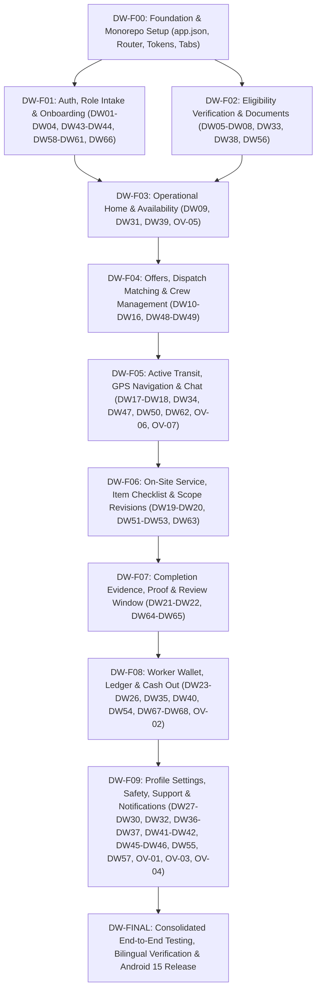

# HAULIX Driver & Worker Mobile App

# Frontend Implementation Roadmap (DW-F00 — DW-FINAL)

**Application:** `apps/driver` (`com.haulix.driver`)  
**Design Reference:** Page `1:3` (`02 — HAULIX Driver & Worker App · iOS Android · EN ES`)  
**Target Architecture:** Expo SDK 58.0.23, NativeWind 4.2.7, Expo Router 58.0.30  
**Baseline Commit:** Current HEAD

---

## 1. Phased Frontend Implementation Packages

---

## 2. Package Scope & Deliverables

|  Package ID  | Package Name                       |                    Canonical Screen Scope                    | Core Component Deliverables                                                                              |           Pre-requisites            |
| :----------: | :--------------------------------- | :----------------------------------------------------------: | :------------------------------------------------------------------------------------------------------- | :---------------------------------: |
|  **DW-F00**  | Monorepo Setup & Foundation        |                   Architectural Foundation                   | `app.json`, `app/_layout.tsx`, 5-Tab navigator layout, NativeWind theme setup, ErrorBoundary, Auth store | Approval of DW-FINAL design handoff |
|  **DW-F01**  | Role Intake & Authentication       |               11 canonical states (22 screens)               | `DW01–DW04`, `DW43–DW44`, `DW58–DW61`, `DW66`                                                            |               DW-F00                |
|  **DW-F02**  | Eligibility & Document Submission  |               7 canonical states (14 screens)                | `DW05–DW08`, `DW33`, `DW38`, `DW56`                                                                      |               DW-F00                |
|  **DW-F03**  | Operational Home & Availability    |           3 canonical states (6 screens) + `OV-05`           | `DW09`, `DW31`, `DW39`, Availability bottom-sheet                                                        |           DW-F01, DW-F02            |
|  **DW-F04**  | Dispatch Offers & Crew Management  |               9 canonical states (18 screens)                | `DW10–DW16`, `DW48–DW49`                                                                                 |               DW-F03                |
|  **DW-F05**  | Active Navigation, Routing & Chat  |      6 canonical states (12 screens) + `OV-06`, `OV-07`      | `DW17–DW18`, `DW34`, `DW47`, `DW50`, `DW62`, Phone call & GPS permission modals                          |               DW-F04                |
|  **DW-F06**  | On-Site Service & Scope Revisions  |               6 canonical states (12 screens)                | `DW19–DW20`, `DW51–DW53`, `DW63`                                                                         |               DW-F05                |
|  **DW-F07**  | Service Completion & Proof         |                4 canonical states (8 screens)                | `DW21–DW22`, `DW64–DW65`                                                                                 |               DW-F06                |
|  **DW-F08**  | Worker Wallet & Cash Out           |          9 canonical states (18 screens) + `OV-02`           | `DW23–DW26`, `DW35`, `DW40`, `DW54`, `DW67–DW68`, Payout method modal                                    |               DW-F07                |
|  **DW-F09**  | Profile, History, Safety & Support | 13 canonical states (26 screens) + `OV-01`, `OV-03`, `OV-04` | `DW27–DW30`, `DW32`, `DW36–DW37`, `DW41–DW42`, `DW45–DW46`, `DW55`, `DW57`                               |               DW-F08                |
| **DW-FINAL** | Release Candidate & Field Testing  |                        All 68 States                         | End-to-end integration, Android 15 testing on Realme Note 60, bilingual verification                     |        DW-F00 through DW-F09        |
