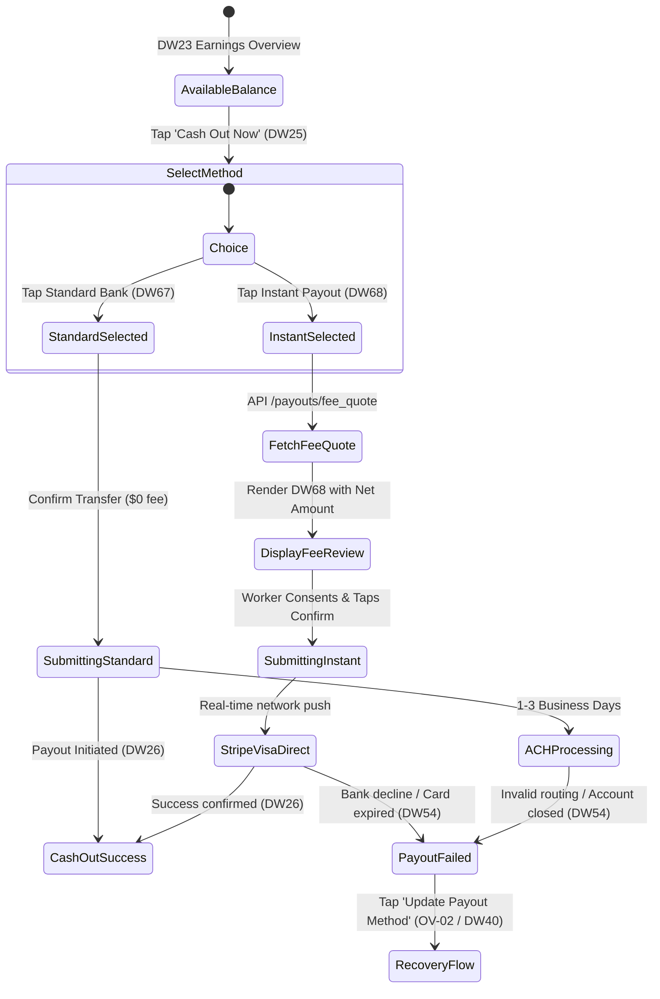

# HAULIX Driver/Worker Mobile App — Phase DW-D08

## Standard Bank Cash Out & Instant Payout Technical Specification

**Phase Reference:** DW-D08  
**Authoritative Figma File:** `meiXxwUNJaDo0a3mhcHBXv`  
**Canvas Page:** `1:3` (`02 — HAULIX Driver & Worker App · iOS Android · EN ES`)  
**Core Screens:**
- `DW25 · Cash Out Methods / Instant Cash Out` (EN `1086:765`, ES `1088:1094`)
- `DW26 · Cash Out Status` (EN `1086:802`, ES `1088:1131`)
- `DW67 · Standard Bank Cash Out` (EN `1325:1804`, ES `1325:1938`)
- `DW68 · Instant Fee & Payout Review` (EN `1325:1866`, ES `1325:2000`)
- `OV-02 · Update Payout Method Preview` (EN `1282:529`, ES `1282:539`)

---

### 1. Cash Out Methods Comparison & Architectural Gating

HAULIX provides workers with two distinct mechanisms to disburse accrued available earnings:

| Architectural Property | Standard Bank Transfer (`DW67`) | Instant Cash Out (`DW25` / `DW68`) |
|:---|:---|:---|
| **Underlying Rail** | Automated Clearing House (ACH) / Direct Deposit | Visa Direct / Mastercard Send via Stripe Instant Payouts |
| **Settlement Velocity** | 1 to 3 Business Days | 15 to 30 Minutes (Real-Time) |
| **Destination Instrument** | Verified Checking/Savings Account (Routing + Account) | Eligible Debit Card (Linked to checking account) |
| **Platform / Provider Fee** | **$0.00 (Free / No Fee)** | **Provider-Calculated Fee** (Disclosed before consent) |
| **Figma Canvas Rule** | Canvas `1325:1804`: *"No platform fee · 1-3 business days"* | Canvas `1325:1914`: *"Provider-calculated fee must appear before approval"* |
| **Minimum Cash Out** | $1.00 | $5.00 |
| **Daily Transfer Limit** | $5,000 / day | $2,000 / day (or provider-imposed rolling cap) |
| **Consent Requirement** | Single confirmation tap | Mandatory explicit disclosure & consent of fee & net receipt |

---

### 2. Instant Cash Out Fee Architecture & Disclosure Gate

#### 2.1 The Fee Calculation Formula
$$\text{Net Worker Receipt} = \text{Requested Amount} - \text{Disclosed Provider Fee}$$

- **Dynamic Provider Calculation:**
  - The provider fee is dynamically quoted via Stripe Connect API endpoint (`/v1/payouts/fee_quote`) based on card network rules, currency, and volume tier.
  - Typical market range: 1.5% with a minimum floor ($0.50) or as dictated by the payment partner.
  - **Critical Rule:** The app must NEVER hardcode a fee. The fee shown on `DW68` (`1325:1866`) is fetched live from the provider before rendering the confirmation screen.

#### 2.2 Pre-Consent Disclosure UX (`DW68`)
- The worker is presented with:
  1. Transfer Amount: e.g. `$385.20`
  2. Instant Processing Fee: e.g. `-$5.78` (Itemized line)
  3. Net Deposited Amount: e.g. `$379.42` (Emphasized lime green total)
  4. Destination Card: `Visa ending in 9012`
  5. Estimated Arrival: `Within 30 minutes`
- Primary CTA: `Confirm & Transfer Now`
- Secondary CTA: `Cancel & Use Standard Transfer (Free)`

---

### 3. End-to-End Cash Out State Machine

---

### 4. Supporting Overlay OV-02 Specification

- **Node Identity:** EN `1282:529`, ES `1282:539`
- **Context:** Modal bottom sheet triggered from `DW40` (Payout Account) or directly during cash-out selection when modifying default disbursement instruments.
- **Form Controls:**
  - Option A: Direct Bank Account (Routing Number, Account Number, Account Holder Name, Checking/Savings toggle).
  - Option B: Instant Debit Card (16-digit PAN, Expiration MM/YY, CVV, Billing ZIP).
- **Security & Tokenization:**
  - Full card PAN and CVV are tokenized directly via Stripe Mobile Elements SDK. HAULIX mobile application code and backend databases NEVER touch raw card numbers or CVV codes (PCI-DSS Scope Reduction).
