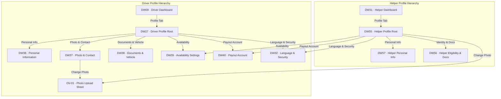

# HAULIX Driver/Worker Mobile App — Phase DW-D09

## Driver & Helper Profile Architecture Specification

**Phase Reference:** DW-D09  
**Authoritative Figma File:** `meiXxwUNJaDo0a3mhcHBXv`  
**Canvas Page:** `1:3` (`02 — HAULIX Driver & Worker App · iOS Android · EN ES`)  
**Core Screens:**
- Primary Driver Profile: `DW27` (EN `1086:840`, ES `1088:1169`)
- Primary Driver Personal Information: `DW36` (EN `1270:428`, ES `1270:1379`)
- Primary Driver Photo & Contact: `DW37` (EN `1270:550`, ES `1270:1501`)
- Crew Helper Profile: `DW55` (EN `1301:1534`, ES `1301:2776`)
- Crew Helper Personal Information: `DW57` (EN `1302:696`, ES `1302:787`)
- Profile Photo Action Overlay: `OV-01` (EN `1281:519`, ES `1282:518`)

---

### 1. Executive Summary & Role Separation Invariant

In strict adherence to Monorepo Architecture Rule #3 (*"Preserve Role Boundaries — Customer and Driver apps are independent; Driver role is determined exclusively by backend eligibility data"*):

1. **Strict Profile Bifurcation:**
   - A verified **Primary Driver** accesses `DW27` as their profile root. `DW27` exposes vehicle credentials, cargo capacity specifications, carrier documentation (`DW38`), operational availability radius (`DW39`), and connected payout methods (`DW40`).
   - A verified **Crew Helper** accesses `DW55` as their profile root. `DW55` omits all commercial vehicle, cargo volume, and DOT registration requirements, focusing purely on individual worker identity (`DW56`), labor availability, personal profile data (`DW57`), and independent payout accounts (`DW40`).
2. **No Local Role Switching:**
   - There is no client-side role toggle on either `DW27` or `DW55`. Role attributes are cryptographically signed in JWT claims issued by the HAULIX authentication service.

---

### 2. Functional Comparison & Data Model

| Profile Field / Feature | Primary Driver (`DW27` / `DW36`) | Crew Helper (`DW55` / `DW57`) | Technical Source & Validation |
|:---|:---:|:---:|:---|
| **Avatar / Profile Photo** | Required (`DW37` / `OV-01`) | Required (`DW55` / `OV-01`) | Facial verification / Live camera selfie |
| **Legal Name & Contact** | Required (Phone, Email, Physical Address) | Required (Phone, Email, Physical Address) | KYC / Stripe Identity verification |
| **Tax ID / SSN / EIN** | Required (Form 1099-NEC / Stripe Custom) | Required (Form 1099-NEC / Stripe Express) | W-9 compliance validation |
| **Driver License & Real ID** | Mandatory (Class A/B/C + State) | Optional (State ID / Passport accepted) | DMV records & background check (`DW07`/`DW56`) |
| **Vehicle Registration & Insurance** | Mandatory (Commercial / Personal auto policy) | **N/A (Hidden / Omitted)** | Primary carrier insurance validation (`DW38`) |
| **Cargo Bed Dimensions / Equipment** | Mandatory (Liftgate, Dollies, Straps) | **N/A (Hidden / Omitted)** | Dispatch matching algorithm (`DW10`/`DW52`) |
| **Operating Radius & Hours** | Configurable (10–50 miles, `DW39`) | Configurable (City/Transit zones, `DW39`) | Geo-fenced availability schedule |
| **Direct Payout Account** | Required (`DW40` Stripe Connect) | Required (`DW40` Stripe Connect) | Individual banking rail (ACH / Debit) |
| **Root Navigation Hotspots** | Home (`DW09`), Jobs (`DW10`), Earnings (`DW23`), Messages (`DW18`) | Home (`DW31`), Jobs (`DW14`), Earnings (`DW23`), Messages (`DW18`) | Role-specific tab navigation targets |

---

### 3. Navigation & Screen Hierarchy

---

### 4. Supporting Overlay OV-01 Integration

- **Node Identity:** EN `1281:519`, ES `1282:518`
- **Context:** Modal bottom sheet triggered from `DW37` (Driver) or `DW55` (Helper) when updating avatar.
- **Controls:**
  1. `Take New Photo` (Launches native camera with circular face guideline).
  2. `Choose from Photo Library` (Launches native image picker).
  3. `Cancel` (Dismisses overlay without modifying avatar state).
- **Security Constraint:** Profile photos undergo automated facial likeness verification against government ID photos on file (`DW07`/`DW56`) to prevent account sharing or driver substitution fraud.
