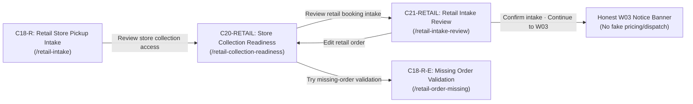
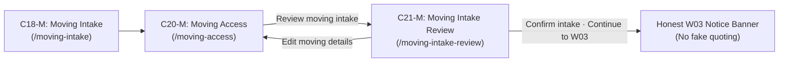
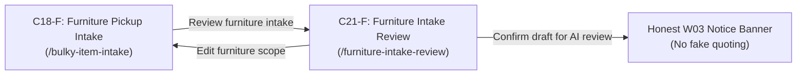

# Phase 03.25 — Figma Source & Navigation Integration Audit

## 1. Authoritative Figma Frame Mapping

| Screen ID      | Screen Name                    | Node ID (EN) | Node ID (ES) | Canvas Size   | Route Path                     |
| :------------- | :----------------------------- | :----------- | :----------- | :------------ | :----------------------------- |
| **C20-RETAIL** | Review store collection access | `392:265`    | `980:10668`  | 430 × 1720 px | `/retail-collection-readiness` |
| **C21-RETAIL** | Retail pickup intake review    | `392:456`    | `980:10886`  | 430 × 1043 px | `/retail-intake-review`        |
| **C21-M**      | Moving intake review           | `392:354`    | `980:10766`  | 430 × 1043 px | `/moving-intake-review`        |
| **C21-F**      | Furniture Pickup intake review | `394:188`    | `980:11006`  | 430 × 1043 px | `/furniture-intake-review`     |

---

## 2. Canonical Routing & Flow Integration

### A. Retail Collection Flow

### B. Residential Moving Flow

### C. Bulky Furniture Removal Flow

---

## 3. Customer Profile & Persona Isolation

- **Integrated Runtime:** Uses dynamic customer profile from `useCustomerProfile` (`Sarah Mitchell` for EN, `Bryan Lopez` for ES).
- **Service Fixture Isolation:** The illustrative persona references in Figma (`Emily Parker` for retail, `Daniel Ruiz` for moving, `Sarah Mitchell` for furniture) are encapsulated within `c25ServiceReviews.ts` to provide faithful visual alignment while keeping profile state dynamic.
