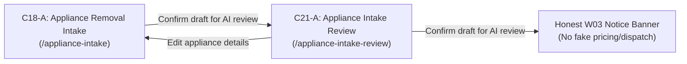
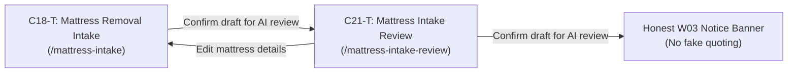
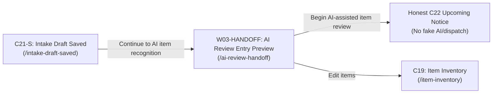

# Phase 03.26 — Figma Source & Navigation Integration Audit

## 1. Authoritative Figma Frame Mapping

| Screen ID       | Screen Name                                                 | Node ID (EN) | Node ID (ES) | Canvas Size   | Route Path                 |
| :-------------- | :---------------------------------------------------------- | :----------- | :----------- | :------------ | :------------------------- |
| **C21-A**       | Appliance Removal intake review                             | `394:290`    | `980:11066`  | 430 × 1043 px | `/appliance-intake-review` |
| **C21-T**       | Mattress Removal intake review                              | `394:392`    | `980:11126`  | 430 × 1043 px | `/mattress-intake-review`  |
| **C21-G**       | Garage Cleanout intake review                               | `394:494`    | `980:11186`  | 430 × 1043 px | `/garage-intake-review`    |
| **W03-HANDOFF** | AI Recognition & Quotation available / Solicitud y revisión | `382:2161`   | `980:10514`  | 430 × 1043 px | `/ai-review-handoff`       |

---

## 2. Canonical Routing & Flow Integration

### A. Appliance Removal Flow

### B. Mattress Removal Flow

### C. Garage Cleanout Flow

### D. Junk Removal AI Review Handoff

---

## 3. Customer Profile & Persona Isolation

- **Integrated Runtime:** Uses customer booking context with verified tokens (`colors.brand` neon lime `#BAFF42`, green badge container `#1A2510`).
- **Service Draft Isolation:**
  - `C21-A`: `SARAH MITCHELL · HX-DEMO-APPL-1036` (Washing machine ×1 · 27 × 29 × 39 in · ~170 lb)
  - `C21-T`: `SARAH MITCHELL · HX-DEMO-MATT-1037` (Queen mattresses ×2 · 80 × 60 × 11 in each)
  - `C21-G`: `SARAH MITCHELL · HX-DEMO-GAR-1040` (Cardboard boxes and shelving · exact count not supplied)
  - `W03-HANDOFF`: `SARAH MITCHELL · HX-DEMO-1027` (3 item types / 4 pieces · 4 attached demo images)
- **Truthful Architecture:** No artificial quotation, fake AI inference, or simulated driver dispatch has been fabricated.
