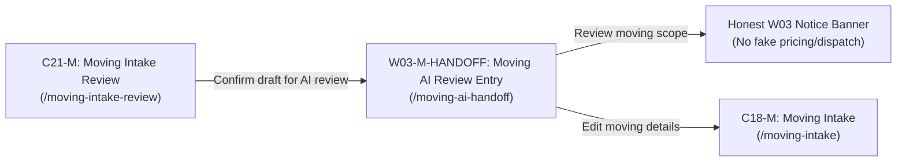
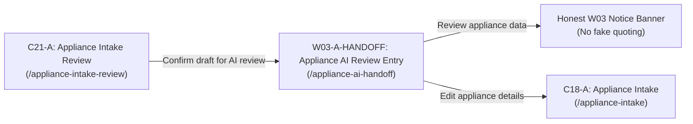
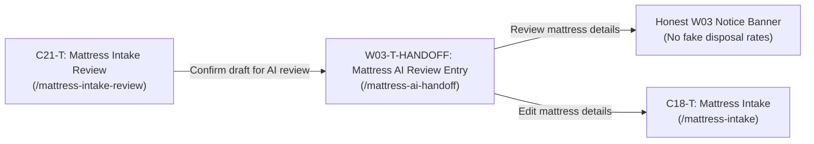
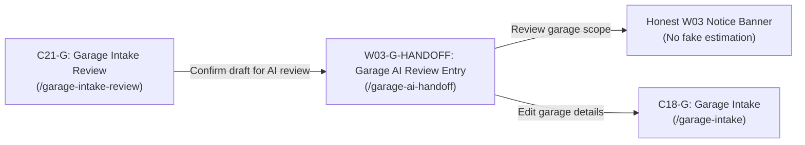

# Phase 03.27 — Figma Source & Navigation Integration Audit

## 1. Authoritative Figma Frame Mapping

| Screen ID         | Screen Name                               | Node ID (EN) | Node ID (ES) | Canvas Size   | Route Path              |
| :---------------- | :---------------------------------------- | :----------- | :----------- | :------------ | :---------------------- |
| **W03-M-HANDOFF** | Moving AI Review Entry Preview            | `392:405`    | `980:10826`  | 430 × 1043 px | `/moving-ai-handoff`    |
| **W03-A-HANDOFF** | Appliance Removal AI Review Entry Preview | `394:341`    | `980:11306`  | 430 × 1043 px | `/appliance-ai-handoff` |
| **W03-T-HANDOFF** | Mattress Removal AI Review Entry Preview  | `394:443`    | `980:11366`  | 430 × 1043 px | `/mattress-ai-handoff`  |
| **W03-G-HANDOFF** | Garage Cleanout AI Review Entry Preview   | `394:545`    | `980:11426`  | 430 × 1043 px | `/garage-ai-handoff`    |

---

## 2. Canonical Routing & Flow Integration

### A. Moving Journey

### B. Appliance Removal Journey

### C. Mattress Removal Journey

### D. Garage Cleanout Journey

---

## 3. Customer Profile & Persona Isolation

- **Integrated Runtime:** Uses customer booking context with verified tokens (`colors.brand` neon lime `#BAFF42`, green badge container `#1A2510`, dark background `#080B0B`).
- **Dynamic Customer Persona Resolution:**
  - **English Variants:** Primary customer persona `Sarah Mitchell` (or `Daniel Ruiz` depending on active profile state).
  - **Spanish Variants:** Dynamically resolves to `Bryan Lopez Mendoza` (as specified in Section 8 of the Phase 03.27 specification).
- **Service Draft Isolation:**
  - `W03-M-HANDOFF`: `SARAH MITCHELL · HX-DEMO-MOV-1042` (2 bedroom apartment, elevator, origin & destination addresses, 14 verified inventory items).
  - `W03-A-HANDOFF`: `SARAH MITCHELL · HX-DEMO-APPL-1036` (Commercial double-door refrigerator, ground level, disconnect pending, ~240 lb).
  - `W03-T-HANDOFF`: `SARAH MITCHELL · HX-DEMO-MATT-1037` (2 Queen mattresses + box spring, 2nd floor stairs, bagged, dry condition).
  - `W03-G-HANDOFF`: `SARAH MITCHELL · HX-DEMO-GAR-1040` (2-car garage ~50% volume, wood & metal shelving, boxes, no hazardous materials).
- **Truthful Architecture:**
  - Prototype frontend handoff only.
  - Zero simulated artificial intelligence inference or fabricated recognition models.
  - Zero mock pricing calculations, instant dispatch, payment processing, or quotation simulation.
