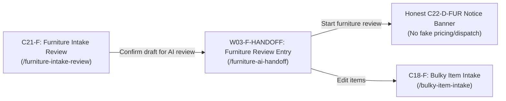
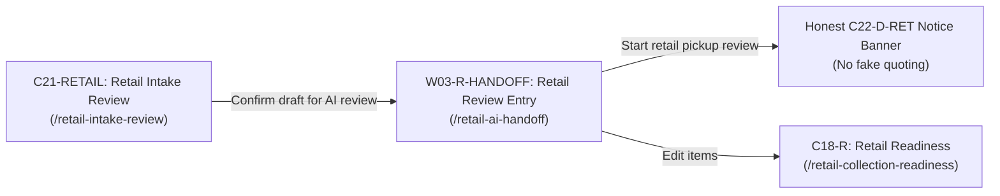
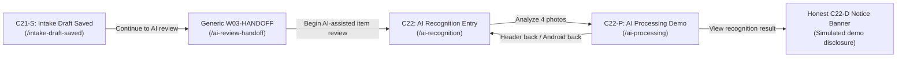

# Phase 03.28 — Figma Source & Navigation Integration Audit

## 1. Authoritative Figma Frame Mapping

| Screen ID         | Screen Name                           | Node ID (EN) | Node ID (ES) | Canvas Size   | Route Path              |
| :---------------- | :------------------------------------ | :----------- | :----------- | :------------ | :---------------------- |
| **W03-F-HANDOFF** | Furniture Pickup Review Entry Preview | `394:239`    | `980:11246`  | 430 × 1043 px | `/furniture-ai-handoff` |
| **W03-R-HANDOFF** | Retail Pickup Review Entry Preview    | `392:507`    | `980:10946`  | 430 × 1043 px | `/retail-ai-handoff`    |
| **C22**           | AI Recognition Entry Preview          | `412:195`    | `987:9929`   | 430 × 1547 px | `/ai-recognition`       |
| **C22-P**         | AI Processing Demonstration Preview   | `412:262`    | `987:10006`  | 430 × 1425 px | `/ai-processing`        |

---

## 2. Canonical Routing & Flow Integration

### A. Furniture Pickup Journey

### B. Retail Pickup Journey

### C. General AI Recognition & Processing Journey

---

## 3. Customer Profile & Persona Isolation

- **Integrated Runtime:** Uses customer booking context with verified design tokens (`colors.brand` neon lime `#BAFF42`, green ledger badge `#1A2510`, dark container background `#080B0B`).
- **Dynamic Customer Persona Resolution:**
  - **Furniture & C22/C22-P (English):** Primary customer persona `Sarah Mitchell`.
  - **Furniture & C22/C22-P (Spanish):** Dynamically resolves to `Bryan Lopez Mendoza` (as specified in Section 8).
  - **Retail Pickup:** Preserves authoritative Figma persona `Emily Parker` (`HX-DEMO-RETAIL-1035`) across both locales.
- **Service Draft Isolation:**
  - `W03-F-HANDOFF`: `SARAH MITCHELL · HX-DEMO-FURN-1039` (3-seat fabric sofa ×1 · 82 × 35 × 34 in · ~125 lb · pickup at 1234 E Example Lane).
  - `W03-R-HANDOFF`: `EMILY PARKER · HX-DEMO-RETAIL-1035` (Home Depot · HD-DEMO-58321 · manually provided order · destination 5678 N Demo Ave · shelving ×2, boxed furniture ×1).
  - `C22`: `SARAH MITCHELL · HX-DEMO-1027` (Junk Removal · 3 item types / 4 pieces · 4 photographs: Sofa, Queen mattresses, Dining table, Other junk).
  - `C22-P`: `SARAH MITCHELL · HX-DEMO-1027` (Simulated AI processing state · 4 demonstration progress rows · 2 analyzed evidence photos).
- **Truthful Architecture:**
  - Prototype frontend handoff and simulation only.
  - Zero simulated artificial intelligence inference or fabricated recognition models.
  - Zero mock pricing calculations, instant dispatch, payment processing, or quotation simulation.
