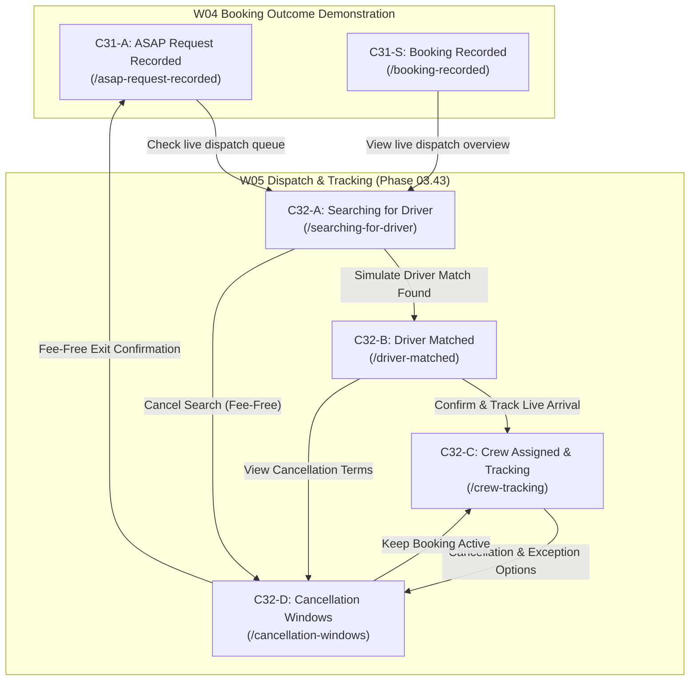

# HAULIX Customer Mobile App — Phase 03.43

## Figma Prototype to Expo Router Audit (W05 Dispatch)

### 1. Handoff Flow Diagram

---

### 2. Route Manifest & Parameter Propagation

| Screen ID | Expo Route              | Screen Title (EN / ES)                                             | Inbound Navigation                                           | Primary Outbound Navigation | Secondary Outbound Navigation   |
| :-------- | :---------------------- | :----------------------------------------------------------------- | :----------------------------------------------------------- | :-------------------------- | :------------------------------ |
| **C32-A** | `/searching-for-driver` | Searching for Driver / Buscando conductor                          | `/asap-request-recorded`, `/booking-recorded`                | `/driver-matched`           | `/cancellation-windows`         |
| **C32-B** | `/driver-matched`       | Driver matched! / ¡Conductor encontrado!                           | `/searching-for-driver`                                      | `/crew-tracking`            | `/cancellation-windows`         |
| **C32-C** | `/crew-tracking`        | Crew assigned & en route / Equipo asignado y en camino             | `/driver-matched`                                            | Detailed Summary Modal      | `/cancellation-windows`         |
| **C32-D** | `/cancellation-windows` | Cancellation windows & policy / Ventanas y política de cancelación | `/crew-tracking`, `/driver-matched`, `/searching-for-driver` | Return to `/crew-tracking`  | Fee-Free Exit / Support Contact |

---

### 3. Hardware Back Button & Fallback Handling

- **`BackHandler` integration:** Implemented on every screen with custom `useCallback` back handler.
- **Deep-linking resilience:** If stack history is empty (`!router.canGoBack()`), back actions fall back deterministically to the natural upstream step rather than crashing or exiting the app.
- **`previewLocale` preservation:** All navigation transitions forward and backward pass `{ previewLocale: currentLocale }` to maintain user locale selection.
