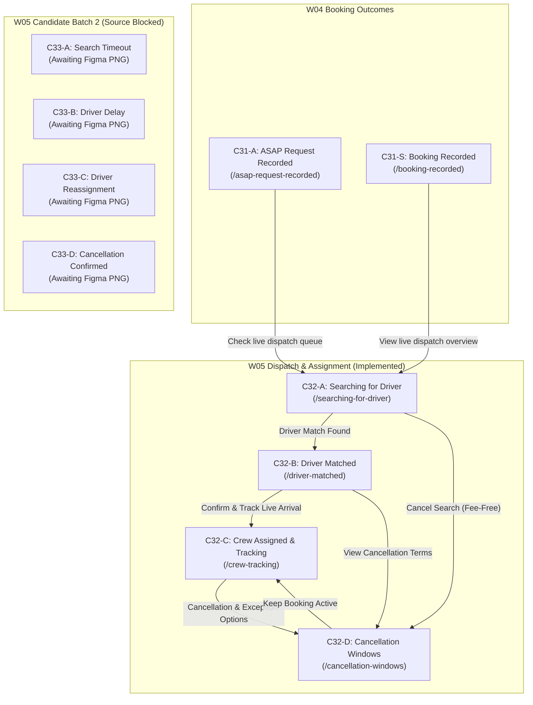

# HAULIX Customer Mobile App — Phase 03.45

## Figma to Expo Router CTA & Interactive Navigation Audit

**PROJECT:** HAULIX Customer Mobile App  
**PHASE:** 03.45  
**WORKFLOW:** W05 Dispatch & Assignment

---

### 1. Prototype Navigation Topology (Existing Verified Flow)

The verified interactive routing structure for W05 Dispatch & Assignment is shown below:

---

### 2. Comprehensive CTA Action Register

| Screen    | Interactive Element                     | Trigger / Gesture | Target Expo Route                                | State Effect            | Locale Preserved      | Status       |
| :-------- | :-------------------------------------- | :---------------- | :----------------------------------------------- | :---------------------- | :-------------------- | :----------- |
| **C32-A** | Header Back Arrow                       | Press             | Stack pop / fallback to `/asap-request-recorded` | None                    | Yes (`previewLocale`) | **VERIFIED** |
| **C32-A** | Match Simulation CTA                    | Press             | `/driver-matched`                                | Matches Marcus Vance    | Yes (`previewLocale`) | **VERIFIED** |
| **C32-A** | Cancel Search CTA                       | Press             | `/cancellation-windows`                          | Navigates to terms      | Yes (`previewLocale`) | **VERIFIED** |
| **C32-B** | Header Back Arrow                       | Press             | Stack pop / fallback to `/searching-for-driver`  | None                    | Yes (`previewLocale`) | **VERIFIED** |
| **C32-B** | Primary CTA (`Confirm & Track`)         | Press             | `/crew-tracking`                                 | Status -> Crew en route | Yes (`previewLocale`) | **VERIFIED** |
| **C32-B** | Secondary CTA (`View Cancellation`)     | Press             | `/cancellation-windows`                          | Navigates to terms      | Yes (`previewLocale`) | **VERIFIED** |
| **C32-B** | Driver Call Icon                        | Press             | Toast alert (`Simulated call connected`)         | None                    | Yes (`previewLocale`) | **VERIFIED** |
| **C32-B** | Driver Chat Icon                        | Press             | Toast alert (`Simulated chat opened`)            | None                    | Yes (`previewLocale`) | **VERIFIED** |
| **C32-C** | Header Back Arrow                       | Press             | Stack pop / fallback to `/driver-matched`        | None                    | Yes (`previewLocale`) | **VERIFIED** |
| **C32-C** | Primary CTA (`View Detailed Summary`)   | Press             | Modal summary toast                              | Displays active summary | Yes (`previewLocale`) | **VERIFIED** |
| **C32-C** | Secondary CTA (`Cancellation Options`)  | Press             | `/cancellation-windows`                          | Navigates to terms      | Yes (`previewLocale`) | **VERIFIED** |
| **C32-C** | Quick Action Call                       | Press             | Simulated call toast                             | None                    | Yes (`previewLocale`) | **VERIFIED** |
| **C32-C** | Quick Action Chat                       | Press             | Simulated chat toast                             | None                    | Yes (`previewLocale`) | **VERIFIED** |
| **C32-C** | Quick Action Share                      | Press             | Simulated share toast                            | None                    | Yes (`previewLocale`) | **VERIFIED** |
| **C32-D** | Header Back Arrow                       | Press             | Stack pop / fallback to `/crew-tracking`         | None                    | Yes (`previewLocale`) | **VERIFIED** |
| **C32-D** | Primary CTA (`Keep Booking Active`)     | Press             | `/crew-tracking`                                 | Returns to live map     | Yes (`previewLocale`) | **VERIFIED** |
| **C32-D** | Secondary CTA (`Confirm Fee-Free Exit`) | Press             | `/asap-request-recorded`                         | Demonstrates zero fee   | Yes (`previewLocale`) | **VERIFIED** |

---

### 3. Deep-Link & Android Hardware Back Safety

All routes implement `BackHandler` listeners with deterministic fallbacks when `router.canGoBack()` returns false. No empty stack unhandled transitions exist.
